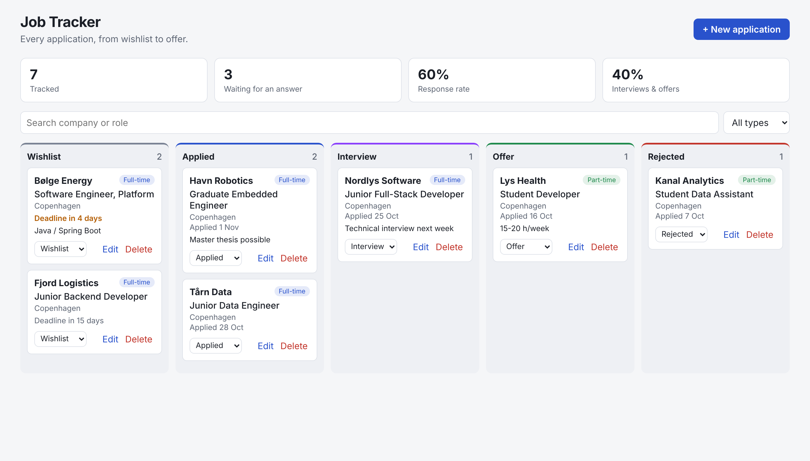
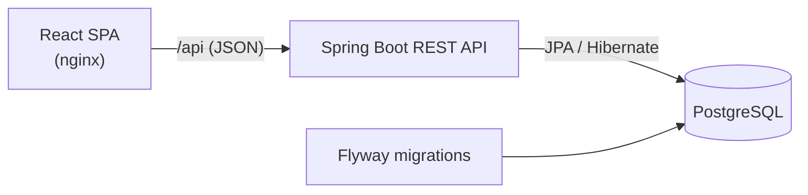

# Job Tracker

A full-stack web app to keep track of job applications, from the first bookmark to the final answer.
Applications sit on a board by stage (wishlist, applied, interview, offer, rejected), and a small dashboard shows how the search is going.

I built it while looking for my first full-time developer role in Copenhagen, to replace a messy spreadsheet.



## Features

- **Board by stage:** move an application between stages from its card
- **Create, edit, delete** applications with company, role, type (full-time, part-time, internship), link, deadline and notes
- **Deadlines that stand out:** wishlist items due within a week are highlighted, overdue ones in red
- **Automatic applied date:** when an application leaves the wishlist, today's date is recorded if none was set
- **Search and filter** by company, role and employment type
- **Import offers from a JSON file** straight into the wishlist, skipping job links that are already tracked. I use it to pull in the postings found by a daily automated job search.
- **Stats:** applications waiting for an answer, response rate, interview and offer rate
- **Validation on both sides:** the form checks input before sending, and the API returns field errors as RFC 9457 problem details, which the form displays
- Light and dark theme, usable on mobile

## Tech stack

| Layer | Technology |
|---|---|
| Frontend | React 18, TypeScript, Vite |
| Backend | Java 17, Spring Boot 3 (Web, Data JPA, Validation, Actuator) |
| Database | PostgreSQL 16, schema managed with Flyway |
| API docs | OpenAPI / Swagger UI (springdoc) |
| Tests | JUnit 5, Spring MockMvc, AssertJ, H2 · Vitest, React Testing Library |
| Delivery | Docker Compose, GitHub Actions CI |

## Architecture



The backend follows a classic layered structure: **controller → service → repository**. Controllers only translate HTTP to and from DTOs (Java records), services hold the business rules, and Spring Data repositories talk to the database. List filters are composed with JPA Specifications, so any combination of status, type and search text uses the same query.

```
backend/src/main/java/dev/lucabailo/jobtracker/
├── application/   entity, repository, service, controller, DTOs
├── stats/         dashboard numbers
├── common/        error handling, clock
└── demo/          sample data for the "demo" profile
frontend/src/
├── api/           typed fetch client
├── components/    Board, ApplicationCard, ApplicationForm, StatsBar
└── lib/           date helpers
```

## REST API

| Method | Path | Description |
|---|---|---|
| GET | `/api/applications?status=&type=&q=` | List, newest first, with optional filters |
| GET | `/api/applications/{id}` | One application |
| POST | `/api/applications` | Create (returns `201` and a `Location` header) |
| POST | `/api/applications/import` | Create many at once, skipping duplicate job links |
| PUT | `/api/applications/{id}` | Update |
| PATCH | `/api/applications/{id}/status` | Move to another stage |
| DELETE | `/api/applications/{id}` | Delete (`204`) |
| GET | `/api/stats` | Counts per stage, response and interview rates |

Interactive docs are available at `http://localhost:8080/api/docs` while the backend is running.

## Running it

### Everything with Docker

Requires Docker Desktop.

```bash
docker compose up --build
```

Open http://localhost:3000. The backend starts with the `demo` profile, which adds a few fictional applications to an empty database.

### Without Docker (in-memory database)

Requires Java 17+, Maven and Node 22. The `local` profile uses an in-memory H2 database in PostgreSQL mode, so nothing else needs to be installed. Data is reset when the backend stops.

```bash
# Terminal 1: backend on http://localhost:8080, with sample data
cd backend
mvn spring-boot:run "-Dspring-boot.run.profiles=local,demo"

# Terminal 2: frontend on http://localhost:5173 (proxies /api to the backend)
cd frontend
npm install
npm run dev
```

To develop against PostgreSQL instead, start only the database with `docker compose up db` and run the backend without the `local` profile.

## Tests

```bash
cd backend && mvn test      # API integration tests (in-memory H2) + stats unit tests
cd frontend && npm test     # component and helper tests
```

Both suites run on every push through GitHub Actions.

## Design decisions

- **Flyway owns the schema.** Hibernate never creates tables (`ddl-auto: none`), so the database structure is versioned and reviewable like code.
- **An injected `Clock`.** The service never calls `LocalDate.now()` directly, so tests can freeze "today" and check the automatic applied date.
- **Stats as a pure function.** The calculation takes a list of statuses and has no database dependency, so it is unit-tested in isolation, including the empty case that would otherwise divide by zero.
- **No CORS configuration needed.** In development Vite proxies `/api` to Spring Boot, and in Docker nginx does the same, so the browser always talks to a single origin.

## Next steps

- User accounts (Spring Security + JWT) so several people can use one instance
- Drag and drop between columns
- Reminders by email before a deadline
- Testcontainers to run the integration tests against real PostgreSQL

---

Made by [Luca Bailo](https://www.linkedin.com/in/luca-bailo-3375a2230/) · MSc Software Design, IT University of Copenhagen
